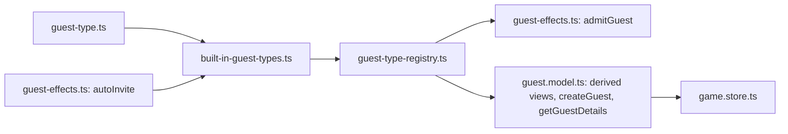

# Design Document: Guest Type Registry

## Overview

Replace the seven parallel tables in `guest.model.ts` with one `GuestTypeDefinition` per type, collected in a registry. Game code reads the registry. The old tables stay as deprecated values derived from the built-in definitions, so the existing specs keep passing while they're migrated.

Step 2 of 5 in the guest extensibility plan. It depends on **guest-identity** (guests are created with `createGuest`, which now reads defaults from the registry).

### Key Design Decisions

1. **`GuestType` becomes `string`**: Runtime-registered types can't be in a compile-time union. The cost is that a typo like `'CLIMBR'` no longer fails to compile; `getGuestType` throwing on unknown ids covers this at runtime, and tests catch it. A `BuiltInGuestType` union of the 22 current ids is kept for places that want compile-time checking (tests, built-in definitions).

2. **A module-level registry, snapshotted per game**: The registry is a simple module (`guest-type-registry.ts`), not an Angular service. Model functions like `admitGuest` and `getGuestDetails` need it, and they aren't in the injection context. `initializeGame()` reads it once to build the deck and shop, so registering a type mid-game can't change the current game's zones (Requirement 5.2). Lookups for guests already in play (labels, effects) read the live registry; since types can't be unregistered or replaced, that's safe.

3. **No unregister or replace**: Registering an existing id throws. Replacing a definition mid-game would change guests already in play. `resetGuestTypesForTesting()` is the only way to remove types, and it's for tests only.

4. **Rosters live on the type**: `SHOP_GUESTS` and `INITIAL_GUESTS` are lists of `{ type, name }`, grouped by type in practice. Moving names onto the definition (`roster.starting`, `roster.shop`) keeps each type in one place. Deck order before shuffling becomes registration order × roster order; the built-ins are registered in the current table order, so the derived lists are identical.

5. **Effects keep their function form for now**: `entranceEffect` is an `EffectHandler` and `entranceIcons` are listed separately, just moved onto the definition. Validation enforces "both or neither", which replaces the sync comment. **effect-descriptors** merges the two.

6. **Validate at registration**: Bad definitions fail fast when registered, not when a guest of that type first enters the party.

## Architecture

### New and Modified Files

```
models/guest-type.ts [new]
├── GuestTypeDefinition [interface]
└── validateGuestType(def): void — throws on the first problem found

models/built-in-guest-types.ts [new]
├── BuiltInGuestType [union of the 22 current ids]
└── BUILT_IN_GUEST_TYPES: readonly GuestTypeDefinition[] — current table order

models/guest-type-registry.ts [new]
├── registerGuestType(def)
├── getGuestType(id) — throws on unknown id
├── findGuestType(id) — undefined on unknown id
├── listGuestTypes() — registration order
└── resetGuestTypesForTesting() — back to built-ins only

models/guest.model.ts
├── GuestType = string
├── Derived views (@deprecated): GUEST_TYPE_LABELS, GUEST_TYPE_DEFAULTS, GUEST_TYPE_COSTS,
│   SHOP_GUESTS, INITIAL_GUESTS, GUEST_TYPE_ENTRANCE_EFFECTS, GUEST_TYPE_ENTRANCE_ICONS
├── createGuest — reads properties from getGuestType(type)
├── admitGuest — reads entranceEffect from findGuestType(type)
└── getGuestDetails — reads entranceIcons from findGuestType(type)

stores/game.store.ts
├── initializeGame — deck and shop built from listGuestTypes()
├── banConfirmationMessage, purchasableShopItems, purchaseGuest — label via guestTypeLabel(type)

components/guest-card.component.ts, phase-content.component.ts
└── labels and shop-card properties from the registry
```

`guestTypeLabel(type)` (in `guest-type-registry.ts`) returns `findGuestType(type)?.label ?? type`, the current fallback in one place.

### Module Load Order

`built-in-guest-types.ts` defines the list. `guest-type-registry.ts` imports it and registers every built-in when the module first loads, so the registry is never empty. The built-in definitions refer to `autoInvite` from `guest.model.ts`; to avoid a circular import, `autoInvite` and `admitGuest` move to a new `models/guest-effects.ts`, which imports the registry.



`autoInvite` uses `admitGuest`, which reads the registry, but only when the effect runs, never at module load. The cycle `guest-effects → registry → built-ins → guest-effects` is safe under ES module semantics on two conditions:

- `autoInvite` and `admitGuest` are `function` declarations (initialized before any module body runs), and no top-level code calls them.
- The shared icons (`INVITE_ICON`, `PEACE_ICON`, …) live in a leaf module, `models/guest-icons.ts`, not in `guest-effects.ts`. Built-in definitions read them at module load, and a `const` in a module still being evaluated would throw.

A unit test imports each module first, in isolation, to guard this.

## Components and Interfaces

### GuestTypeDefinition (models/guest-type.ts)

```typescript
export interface GuestTypeDefinition {
  id: string;
  label: string;
  // Popularity to buy one from the shop; null when the type is never sold.
  cost: number | null;
  properties: GuestProperties;
  roster: {
    starting: readonly string[];  // in the starting deck
    shop: readonly string[];      // in the shop
  };
  // Runs when a guest of this type joins the party. Requires entranceIcons.
  entranceEffect?: EffectHandler;
  entranceIcons?: readonly GuestIcon[];
}
```

### Example built-in definition (models/built-in-guest-types.ts)

```typescript
{
  id: 'CELEBRITY',
  label: 'Celebrity',
  cost: 11,
  properties: { popularityValue: 2, troubleValue: 0, moneyValue: 3, peaceValue: 0, starValue: 0 },
  roster: { starting: [], shop: ['Troy', 'Rainier', 'Pedro', 'Kent'] },
  entranceEffect: (ctx) => { autoInvite(ctx); autoInvite(ctx); },
  entranceIcons: [INVITE_ICON, INVITE_ICON]
}
```

Wild Buddy is the one type with a starting roster and no shop roster (`cost: null`). Old Friend and Rich Pal have both.

### Registry (models/guest-type-registry.ts)

```typescript
const registry = new Map<string, GuestTypeDefinition>();

export function registerGuestType(def: GuestTypeDefinition): void {
  if (registry.has(def.id)) throw new Error(`Guest type "${def.id}" is already registered`);
  validateGuestType(def);
  registry.set(def.id, def);
}

export function getGuestType(id: string): GuestTypeDefinition {
  const def = registry.get(id);
  if (!def) throw new Error(`Unknown guest type "${id}"`);
  return def;
}

export const findGuestType = (id: string) => registry.get(id);
export const listGuestTypes = (): GuestTypeDefinition[] => [...registry.values()];  // Map keeps insertion order
export const guestTypeLabel = (id: string) => registry.get(id)?.label ?? id;

export function resetGuestTypesForTesting(): void {
  registry.clear();
  BUILT_IN_GUEST_TYPES.forEach(registerGuestType);
}

BUILT_IN_GUEST_TYPES.forEach(registerGuestType);
```

Both checks (duplicate id, then Requirement 3 validation) run before `registry.set`, so a rejected definition never lands in the map.

### Derived views (guest.model.ts)

```typescript
/** @deprecated Use getGuestType(id).label */
export const GUEST_TYPE_LABELS: Record<string, string> =
  Object.fromEntries(BUILT_IN_GUEST_TYPES.map(d => [d.id, d.label]));

/** @deprecated Use getGuestType(id).roster.shop */
export const SHOP_GUESTS: readonly { type: GuestType; name: string }[] =
  BUILT_IN_GUEST_TYPES.flatMap(d => d.roster.shop.map(name => ({ type: d.id, name })));
```

The others follow the same pattern. They're built from `BUILT_IN_GUEST_TYPES`, not the live registry, so runtime registrations and tests that register extra types don't change them (Requirement 6.3).

### initializeGame (game.store.ts)

```typescript
const nextId = createGuestIdSource();
const types = listGuestTypes();

const deck = types.flatMap(t => t.roster.starting.map(name => createGuest(t.id, name, nextId)));
shuffleDeck(deck);

const shopInventory = types
  .filter(t => t.cost !== null && t.roster.shop.length > 0)
  .map(t => ({ type: t.id, cost: t.cost!, guests: t.roster.shop.map(name => createGuest(t.id, name, nextId)) }));
```

As today, starting guests get their ids before shop guests. Nothing depends on id order.

## Data Models

No store state changes. `ShopInventoryEntry.type` and `Guest.type` are now `string`.

## Correctness Properties

### Property 1: Derived Views Match the Old Tables

For every built-in type id, each Derived_View SHALL hold the same value it held before this feature, and `SHOP_GUESTS` and `INITIAL_GUESTS` SHALL list the same `{ type, name }` entries in the same order. (Captured as a snapshot of the current tables, taken before the refactor.)

**Validates: Requirements 1.2, 6.1, 7.1**

### Property 2: Registration Round-Trips

*For any* valid definition with an unused id, `registerGuestType(def)` followed by `getGuestType(def.id)` SHALL return `def`, and `listGuestTypes()` SHALL end with `def`.

**Validates: Requirements 2.1, 2.4**

### Property 3: Invalid Definitions Are Rejected Without Side Effects

*For any* definition that breaks one rule in Requirement 3, `registerGuestType` SHALL throw, and `listGuestTypes()` SHALL be unchanged.

**Validates: Requirements 3.1–3.7**

### Property 4: Runtime Types Join the Next Game

*For any* valid definition registered before `initializeGame()`, the deck SHALL contain exactly one guest per `roster.starting` name of that type, and the shop SHALL contain an entry for the type with its cost and one guest per `roster.shop` name (when cost is non-null).

**Validates: Requirements 4.1, 4.2, 5.1**

### Property 5: Mid-Game Registration Doesn't Touch the Current Game

*For any* valid definition registered after `initializeGame()`, deck, party, discard and shop inventory SHALL be unchanged.

**Validates: Requirements 5.2**

### Property 6: Runtime Types Score Like Built-ins

*For any* runtime-registered type with arbitrary integer properties, a party containing one guest of that type SHALL have trouble, stars, trouble limit and party settlement equal to those of a party containing a built-in-shaped guest with the same properties.

**Validates: Requirements 5.3**

## Error Handling

- Unknown type id in `getGuestType`: throws `Unknown guest type "<id>"`. Used where a missing type is a bug (`createGuest`).
- Unknown type id in display code: falls back to the id via `guestTypeLabel`, as today.
- Invalid definition: `registerGuestType` throws with a message naming the type id and the rule broken.

## Testing Strategy

**Library**: fast-check, minimum 100 iterations per property, tagged `// Feature: guest-type-registry, Property {n}: {title}`.

- Before starting, snapshot the current seven tables to a fixture (`built-in-tables.snapshot.ts`); Property 1 compares against it. Delete the fixture once the derived views are retired.
- Every spec that registers types calls `resetGuestTypesForTesting()` in `afterEach`.
- A generator `arbGuestTypeDefinition()` builds valid definitions (unique `TEST_` ids, integer properties, distinct roster names); `arbInvalidGuestTypeDefinition()` breaks exactly one rule.
- Existing specs keep using the derived views, which is fine. New specs use the registry. The `Record<GuestType, string>` literals in `guest-card.component.property.spec.ts` become `Record<BuiltInGuestType, string>`.
